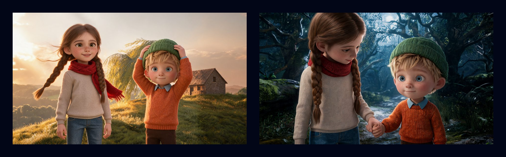
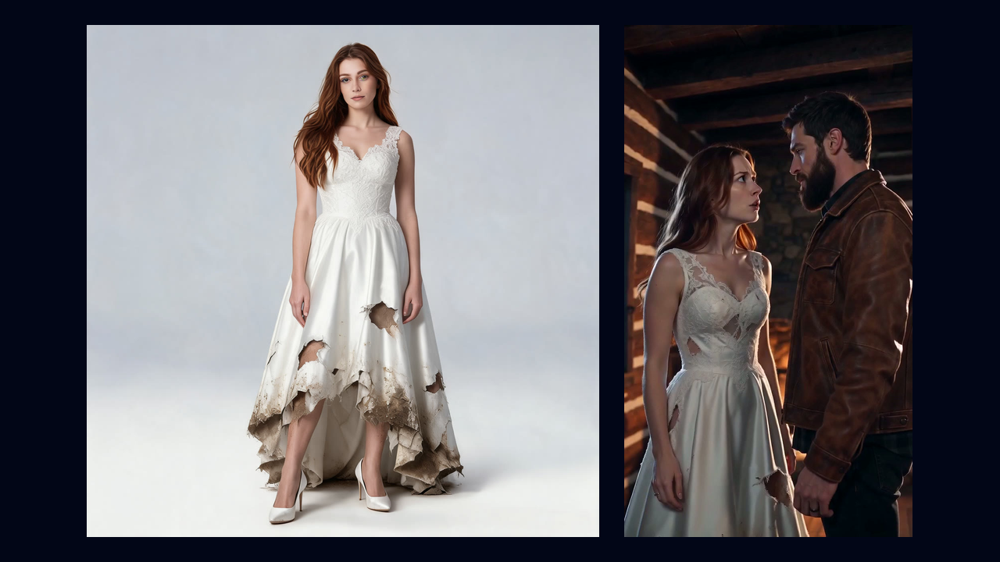
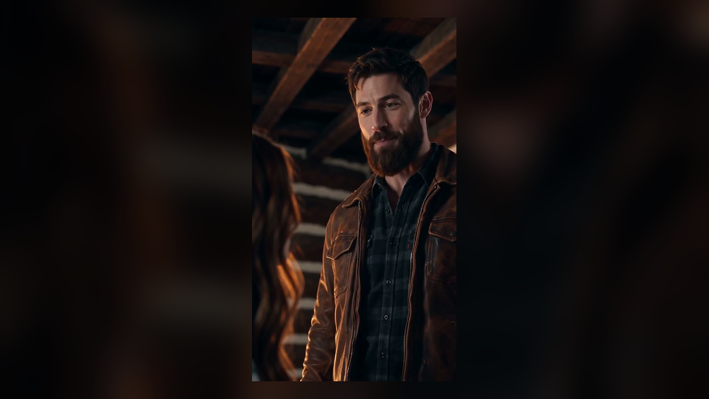

# Zoromi for AI assistants

[Zoromi](https://zoromi.studio) turns a story or an idea into an illustrated book or a short video. Connect it to
your AI assistant to make pictures and video clips, follow your books and video projects, and check your Gems, right
from the chat.



## Connect

**Claude** — Settings → Connectors → Add custom connector. Name it Zoromi and paste:

```
https://zoromi.studio/api/v1/mcp/claude
```

Press Connect, sign in to Zoromi, and choose **read only** or **read and make things** with a daily limit.

**ChatGPT** — Settings → Apps & Connectors → Create (Developer mode, under Advanced). Choose OAuth and paste:

```
https://zoromi.studio/api/v1/mcp/chatgpt
```

**Claude Code**

```
claude mcp add --transport http zoromi https://zoromi.studio/api/v1/mcp/claude
```

**Any other MCP client** (Streamable HTTP):

```
https://zoromi.studio/api/v1/mcp
```

Sign in with OAuth when your client asks, or send an API key from your
[account page](https://zoromi.studio/account) as `Authorization: Bearer zk_live_...`. Keep the key in an environment
variable, never in a chat.

**Agent skill** — teaches your agent which tools to use and when:

```
npx skills add https://zoromi.studio
```

The same skill is in [`skills/zoromi`](skills/zoromi) in this repository.

## What your assistant can do

| Tool | What it does | Needs your account |
|---|---|---|
| `get_zoromi_overview` | What Zoromi makes and how to get started | No |
| `get_video_prices` | Today's prices for video clips | No |
| `get_plans_and_pricing` | The plans and what each includes | No |
| `get_my_account` | Your plan, your Gems and your API balance | Yes |
| `list_my_gems_charges` | Your recent Gems charges and refunds | Yes |
| `list_my_books` / `get_book` | Your illustrated books | Yes |
| `list_my_video_projects` / `get_video_project` | Your video projects | Yes |
| `estimate_image_cost` → `create_image` | One picture from your description | Yes, with permission to make things |
| `estimate_video_clip_cost` → `create_video_clip` | One short video clip, from words or from one of your own pictures | Yes, with permission to make things |
| `get_generation_status` | Whether it's ready, your link to it, and what it took | Yes |
| `estimate_website_clips_cost` | What filming some clips on the website would cost in Gems | Yes |
| `estimate_website_story_video_cost` → `start_website_story_video` → `get_website_story_video_status` | A short-drama project from your script, finished on the website | Yes |

New tools show up in your assistant automatically. The full guide is at
[zoromi.studio/developers](https://zoromi.studio/developers).

## Try it

- "Use Zoromi to make a picture of a lighthouse at dusk."
- "Make a 5-second clip of a red fox running through snow with Zoromi."
- "How many Gems do I have left on Zoromi?"
- "Is my Zoromi video project ready?"
- "Open my book called The Lighthouse Twins."

## Prices

Pictures and clips you make through an assistant are paid in US dollars from your API balance, which is separate from
the Gems you use on the website. Your assistant reads the live price, tells you, and goes ahead after your yes. If a
picture or clip can't be made, its charge goes back to your API balance. Each key or connection has its own daily
limit, which you set on your account page. Books and whole short dramas are made on the website, with Gems.



| | |
|---|---|
|  |  |

## Contact

support@zoromi.studio

## License

The files in this repository are under the [MIT License](LICENSE).
